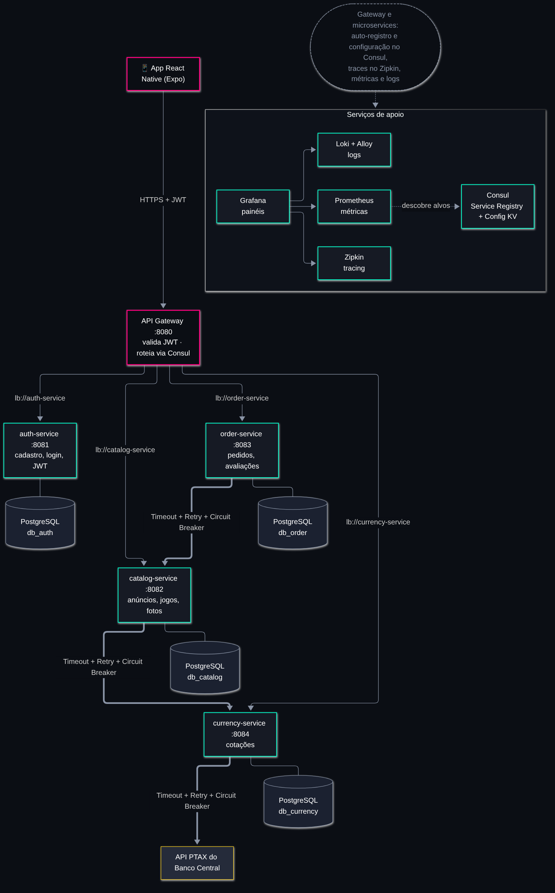

# 🎮 GameDeal

**Marketplace de itens virtuais e serviços para jogos.** Os jogadores compram e vendem skins, armas, moedas e contas, e contratam mentorias (coaching, rank boost, upar). O pagamento fica retido em um "cofre" até o comprador confirmar que recebeu o item.

Projeto da disciplina **Projeto, Design e Engenharia de Processos / Paradigma de Linguagem de Programação** (Atitus).

| | |
|---|---|
| **Frontend** | React Native + Expo (SDK 58), TypeScript, Expo Router |
| **Backend** | Java 21, Spring Boot 4.1, Spring Cloud 2025.1 (microservices) |
| **Infra** | Docker Compose, Consul, PostgreSQL, Prometheus, Grafana, Loki, Zipkin |



---

## 📁 Estrutura do repositório

```
gamedeal/
├── backend/                  # API (microservices)
│   ├── gateway/              # API Gateway: ponto único de entrada, valida JWT
│   ├── auth-service/         # cadastro, login e emissão de JWT
│   ├── catalog-service/      # anúncios, jogos e fotos
│   ├── order-service/        # pedidos, checkout e avaliações
│   ├── currency-service/     # cotações (Banco Central + fallback)
│   ├── infra/                # Consul KV, Prometheus, Grafana, Alloy
│   ├── docker-compose.yml    # sobe todo o ambiente
│   └── .env.example          # segredos de desenvolvimento (copiar para .env)
├── frontend/                 # App React Native (Expo)
│   └── src/
│       ├── app/              # telas (rotas do Expo Router)
│       ├── components/       # componentes reutilizáveis
│       ├── contexts/         # autenticação, carrinho e rascunho de anúncio
│       ├── hooks/            # useApi (carregamento/erro padronizados)
│       ├── services/         # cliente HTTP e chamadas à API
│       ├── theme/            # cores, fontes e espaçamentos do Figma
│       ├── types/            # tipos das respostas da API
│       └── utils/            # formatação e diálogos
└── docs/
    ├── ARQUITETURA.md        # microservices, padrões e decisões
    ├── API.md                # todos os endpoints com cURL
    └── arquitetura.png       # diagrama geral
```

---

## ⚙️ Pré-requisitos

- [Docker Desktop](https://www.docker.com/products/docker-desktop/) (com pelo menos 6 GB de memória liberados)
- [Node.js](https://nodejs.org/) 20 ou superior
- [Git](https://git-scm.com/)
- App [Expo Go](https://expo.dev/go) no celular (SDK 58)

---

## 🚀 Como executar

### 1. Clonar

```bash
git clone <url-do-repositorio> gamedeal
cd gamedeal
```

### 2. Backend

```bash
cd backend
cp .env.example .env          # no Windows (PowerShell): copy .env.example .env
docker compose up --build
```

O primeiro build baixa as dependências Maven e leva alguns minutos. O ambiente está pronto quando o log do `gateway` mostrar `Started GatewayApplication`.

| Serviço | Endereço |
|---|---|
| **API Gateway** (única porta usada pelo app) | http://localhost:8080 |
| Consul (serviços registrados e configurações) | http://localhost:8500 |
| Grafana (painel "GameDeal - Visão geral") | http://localhost:3000 (admin / admin) |
| Zipkin (traces) | http://localhost:9411 |
| Prometheus (métricas) | http://localhost:9090 |

Teste rápido:

```bash
curl http://localhost:8080/listings
```

### 3. Frontend

Em outro terminal:

```bash
cd frontend
npm install
npx expo start
```

- **Celular:** abra o Expo Go e escaneie o QR Code. O celular e o computador precisam estar na **mesma rede Wi-Fi**. O app descobre sozinho o IP do computador para falar com o Gateway.
- **Navegador:** pressione `w` no terminal do Expo.
- **Rede diferente / IP manual:** crie `frontend/.env` com `EXPO_PUBLIC_API_URL=http://SEU_IP:8080`.

> No Windows, se o celular não conectar, libere a porta 8080 no Firewall do Windows para redes privadas.

### 4. Usuários de demonstração

| E-mail | Senha |
|---|---|
| lula@gamedeal.com | gamedeal123 |
| nick@gamedeal.com | gamedeal123 |
| demon@gamedeal.com | gamedeal123 |

Também é possível criar uma conta nova pela tela de cadastro.

---

## 📱 Funcionalidades

| Tela | O que faz |
|---|---|
| Login / Criar conta | Autenticação com JWT, validação dos campos e sessão salva no aparelho |
| Início | Destaque, categorias populares e ofertas em alta |
| Explorar | Busca por nome, filtros por categoria e jogo, paginação infinita |
| Detalhe do item | Fotos, vendedor e reputação, especificações, conversão de preço (R$, US$, €) |
| Serviços | Mentorias filtradas por tipo (Upar, Coaching, Dungeons, Rank Boost), com nota do vendedor |
| Vender (Painel de Vendas) | Anúncios, vendas e faturamento; pausar, editar e excluir anúncios |
| Novo anúncio | Categoria → detalhes (com upload de fotos) → revisão com taxa de 10% → publicado |
| Carrinho (Cofre) | Itens, quantidade, recibo com taxa do cofre de 2,5% e finalização da compra |
| Perfil | Reputação, total de negócios, anúncios ativos e últimas movimentações |
| Minhas compras / Pedido | Status do pedido e confirmação de recebimento (libera o valor ao vendedor) |
| Avaliar vendedor | Nota de 1 a 5, comentário e etiquetas |

---

## 🔭 Demonstração de observabilidade e resiliência

**Trace passando por vários microservices:** faça uma compra no app (ou use o cURL `POST /ws/orders` do [API.md](docs/API.md)). No Zipkin, procure pelo serviço `gateway`. O trace mostra `gateway → order-service → catalog-service`. Abrir um anúncio com preço em US$ mostra `gateway → catalog-service → currency-service`.

**Logs centralizados:** no Grafana, abra *Explore → Loki* e filtre `{service="order-service"}`. Cada linha traz o `traceId`, com link direto para o trace no Zipkin.

**Circuit Breaker:**

```bash
docker compose stop catalog-service
# Tente comprar algo: o order-service responde 503 com mensagem amigável.
# Após 5 falhas o circuito abre; veja no Grafana o painel "Estado dos Circuit Breakers".
docker compose start catalog-service
```

O mesmo vale para `currency-service`: se ele cair, o catálogo continua funcionando e exibe os preços em reais.

---

## 🛑 Comandos úteis

```bash
docker compose ps                         # containers e status
docker compose logs -f order-service      # logs de um serviço
docker compose down                       # para tudo (mantém os dados)
docker compose down -v                    # para tudo e apaga os bancos
```

---

## 📚 Documentação

- [Arquitetura, padrões e decisões](docs/ARQUITETURA.md)
- [Endpoints da API com cURL](docs/API.md)
- Design no Figma: telas de Login, Cadastro, Início, Perfil, Painel de Vendas, Novo Anúncio (4 etapas), Serviços, Detalhe, Finalização e Avaliação.

## 👥 Integrantes

| Nome | RA | Função |
|---|---|---|
| Ariel Chaves | 1136093 | Engenheiro de Qualidade |
| Diego Meira | 1109435 | Líder |
| Eduardo Barreda | 1138704 | Gestor de Projeto |
| João Vitor Buratti | 1136821 | Analista de Requisitos |
| Kael Fuchs Zatti | 1137819 | Desenvolvedor Backend |
| Luis Eduardo | 1134332 | Desenvolvedor Frontend |
| Victor Quadri | 1136643 | Desenvolvedor Backend |
| Vinicius Colussi | 1137833 | Design UX/UI |

> A venda de itens virtuais neste projeto é **simulada e acadêmica**. Pagamentos não são processados e nenhum item real é transferido.
