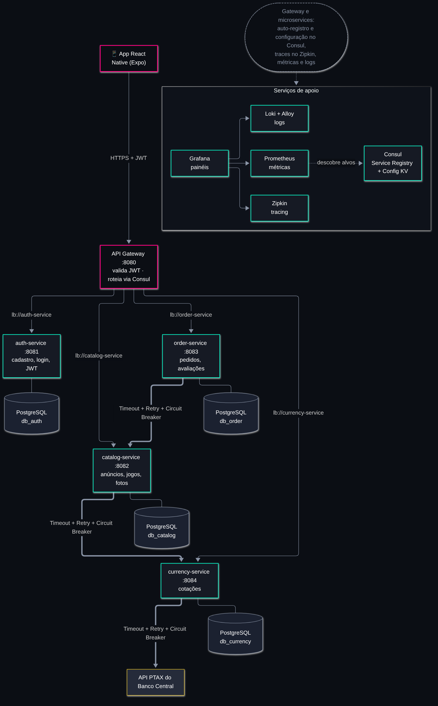

# Arquitetura do GameDeal



O backend segue uma arquitetura de **microservices**: cada domínio do negócio é um serviço Spring Boot independente, com banco próprio, imagem Docker própria e registro automático no Consul. O app acessa tudo por um único ponto de entrada, o **API Gateway**.

---

## 1. Microservices e responsabilidades

| Serviço | Porta interna | Responsabilidade | Banco |
|---|---|---|---|
| `gateway` | 8080 (única exposta) | Ponto único de entrada. Valida o JWT nas rotas `/ws/**`, remove cabeçalhos de identidade forjados, propaga a identidade e roteia via Consul (`lb://`). Também cuida do CORS. | — |
| `auth-service` | 8081 | Cadastro, login (BCrypt) e emissão de tokens JWT; dados do usuário logado e perfil público. | `db_auth` |
| `catalog-service` | 8082 | Anúncios (CRUD do vendedor, busca pública com filtros e paginação), jogos, upload e download de fotos, reserva atômica de estoque. | `db_catalog` |
| `order-service` | 8083 | Orçamento (quote), pedidos com o pagamento retido no cofre, confirmação de recebimento, painel de vendas, avaliações e reputação dos vendedores. | `db_order` |
| `currency-service` | 8084 | Cotações de moedas pela API PTAX do Banco Central, com fallback no último valor salvo. | `db_currency` |

### Serviços de apoio

| Serviço | Papel |
|---|---|
| **Consul** | Service Registry (descoberta) e Centralized Configuration (KV). |
| **consul-config** | Container de inicialização que grava as configurações no Consul KV (`backend/infra/consul/load-config.sh`). |
| **PostgreSQL ×4** | Um banco por microservice. |
| **Zipkin** | Armazena e exibe os traces distribuídos. |
| **Prometheus** | Coleta as métricas `/actuator/prometheus`, descobrindo os alvos pelo Consul. |
| **Loki + Grafana Alloy** | O Alloy lê o stdout de todos os containers e envia ao Loki (logs centralizados). |
| **Grafana** | Painel "GameDeal - Visão geral" com métricas, estado dos circuit breakers e logs; datasources Prometheus, Loki e Zipkin já provisionados. |

---

## 2. Como cada requisito obrigatório foi atendido

### 2.1 Microservices e persistência
- Quatro serviços de negócio, cada um com seu próprio PostgreSQL (**Database per Service**). Nenhuma tabela é compartilhada.
- Entre serviços não há chave estrangeira. O pedido guarda uma **cópia** dos dados do anúncio no momento da compra (título, preço, imagem), então o histórico continua correto mesmo que o anúncio mude depois.
- **Flyway** em todos os serviços (`src/main/resources/db/migration`): `V1` cria as tabelas e `V2` popula os dados de demonstração. O Hibernate roda com `ddl-auto=validate`, ou seja, apenas confere o esquema criado pelo Flyway.

### 2.2 Externalized e Centralized Configuration
- O `application.properties` de cada serviço tem apenas o nome do serviço e o endereço do Consul.
- Todo o resto (porta, datasource, segredo JWT, timeouts, Retry/Circuit Breaker, taxas, observabilidade) fica no **Consul KV**:
  - `config/application/*`: comum a todos os serviços;
  - `config/<serviço>/*`: específico de cada um.
- **Segredos** (usuário/senha dos bancos e chave JWT) vêm do arquivo `.env`, que fica fora do Git. Eles entram no Consul na inicialização e nunca aparecem no código.
- Para mudar de ambiente basta trocar os valores no Consul ou no `.env`, sem recompilar código nem reconstruir imagens.

### 2.3 Comunicação entre microservices e resiliência
São duas comunicações entre serviços de negócio, mais uma com um serviço externo:

| Origem → Destino | Quando | Mecanismos |
|---|---|---|
| `order-service → catalog-service` | Orçamento e compra: consulta o anúncio, reserva o estoque e devolve o estoque se a gravação falhar (compensação). | Timeout (1 s conexão / 3 s leitura), Retry (3 tentativas, **só em operações idempotentes**; a reserva de estoque não é repetida), Circuit Breaker. |
| `catalog-service → currency-service` | Exibir preços em outra moeda. | Timeout (1 s / 2 s), Retry, Circuit Breaker. **Fallback:** se falhar, os preços aparecem em BRL e a vitrine continua funcionando. |
| `currency-service → API do Banco Central` | Cotação atualizada. | Timeout, Retry, Circuit Breaker. **Fallback:** último valor salvo no banco. |

- Clientes declarativos (`@HttpExchange`) sobre `RestClient` com `@LoadBalanced`. O endereço é o **nome do serviço** (`http://catalog-service`), resolvido pelo Consul, sem IP nem porta fixos.
- Erros 4xx (por exemplo "estoque insuficiente") estão em `ignore-exceptions`: são regras de negócio, não falhas, e não abrem o circuito.
- Com o circuito aberto, o order-service responde na hora **503 – "Catálogo temporariamente indisponível"**, em vez de esperar o timeout.

### 2.4 Service Discovery
- **Service Registry:** Consul.
- **Self Registration:** cada serviço se registra sozinho ao iniciar (`spring-cloud-starter-consul-discovery`), com health check em `/actuator/health` e `instance-id` único, o que permite várias instâncias.
- **Client-side Discovery:** `RestClient` `@LoadBalanced` nas chamadas internas.
- **Server-side Discovery:** o Gateway roteia as requisições externas com `lb://<serviço>`.
- O Prometheus também usa o Consul (`consul_sd_configs`) para descobrir o que coletar.

### 2.5 API Gateway e autenticação stateless
- O Gateway é o único container de negócio com porta publicada (8080). Os microservices só são acessíveis dentro da rede Docker.
- O `auth-service` valida login e senha (BCrypt) e emite um **JWT assinado com HMAC-SHA256** (claims: `id`, `email`, `username`, `type`; expira em 24 h).
- O `AuthFilter` do Gateway:
  1. remove `X-User-*` vindos do cliente (evita falsificação de identidade);
  2. nas rotas **`/ws/**`** (protegidas), exige `Authorization: Bearer <token>` válido; caso contrário responde 401;
  3. repassa a identidade aos serviços em `X-User-Id`, `X-User-Email`, `X-User-Name` e `X-User-Type`.
- Os serviços de negócio confiam nesses cabeçalhos e não reautenticam a cada chamada interna.
- **Rotas públicas:** `/auth/**`, `/listings/**`, `/games`, `/images/**`, `/sellers/**`, `/currencies/**`. **Protegidas:** `/ws/**`.
- `/internal/**` (reserva de estoque) **não tem rota no Gateway**, então só o order-service, dentro da rede, consegue chamar.

### 2.6 Observabilidade
- **Logs:** cada linha sai com `[serviço,traceId,spanId]`. O Grafana Alloy coleta o stdout dos containers e envia ao **Loki**, onde a consulta é feita pelo Grafana. O datasource do Loki transforma o traceId em link para o Zipkin.
- **Métricas:** Micrometer + Prometheus (`/actuator/prometheus`): requisições, latência (histograma), JVM (memória, CPU), pool de conexões e estado dos circuit breakers do Resilience4j.
- **Distributed Tracing:** Micrometer Tracing (Brave) + Zipkin, com amostragem de 100%. O contexto é propagado automaticamente pelo Gateway e pelos `RestClient`. Exemplo: `POST /ws/orders` gera um trace `gateway → order-service → catalog-service`.

### 2.7 Containerização e orquestração
- **Um Dockerfile por microservice** (multi-stage: Maven para compilar, JRE para executar, usuário sem privilégios).
- **Service per Container / Multiple Services per Host:** cada serviço em seu container, todos no mesmo host via `docker compose`.
- O `docker-compose.yml` sobe todos os componentes: microservices, auth, gateway, Consul, configuração, bancos e observabilidade.
- A ordem de inicialização é garantida por `depends_on` com condições: bancos `healthy` → Consul `healthy` → `consul-config` concluído → serviços `healthy` → gateway.
- **Volumes** para os bancos, as fotos dos anúncios, o Consul, o Prometheus, o Loki e o Grafana.

### 2.8 Organização interna
Mesma estrutura de pacotes em todos os serviços:

```
controllers/   endpoints REST (sem regra de negócio)
services/      interfaces + impl/ com as regras de negócio
repositories/  Spring Data JPA
entities/      entidades JPA (nunca expostas diretamente)
dtos/          records de entrada/saída com Bean Validation
clients/       clientes HTTP declarativos (@HttpExchange)
configs/       beans de configuração
exceptions/    ApiException + GlobalExceptionHandler (@RestControllerAdvice)
```

- Injeção de dependência por construtor.
- **DTOs** separados das entidades. A senha nunca sai da API.
- Validação com `@Valid` e mensagens em português.
- O `GlobalExceptionHandler` devolve sempre o mesmo formato de erro (`timestamp, status, error, message, path, details`) e **não expõe stack traces**. Erros inesperados ficam só no log.

---

## 3. Fluxo de compra (exemplo ponta a ponta)

1. O app chama `GET /ws/orders/quote?listingId=1&quantity=1` e o Gateway valida o JWT.
2. O `order-service` consulta `catalog-service /internal/listings/1` (Retry + Circuit Breaker) e calcula subtotal, taxa do cofre (2,5%) e total.
3. `POST /ws/orders`: o `order-service` valida as regras (não comprar o próprio anúncio, anúncio ativo, estoque) e chama `POST /internal/listings/1/reserve`. O catálogo faz um `UPDATE ... WHERE quantity >= :qty`, atômico, que evita vender o mesmo item duas vezes.
4. O pedido é salvo como `PAID` (valor retido no cofre). Se a gravação falhar, o estoque é devolvido (`/release`).
5. O comprador confirma o recebimento (`POST /ws/orders/{id}/confirm`), o pedido passa a `COMPLETED` e o valor líquido (subtotal menos 10%) entra no faturamento do vendedor.
6. O comprador avalia o vendedor (`POST /ws/orders/{id}/review`), o que alimenta a reputação exibida no app.

---

## 4. Decisões arquiteturais e adaptações

| Decisão | Justificativa |
|---|---|
| **Consul** para descoberta **e** configuração centralizada | Mesma ferramenta usada em aula. Um único componente cumpre Service Registry e Config Server (KV), o que reduz a quantidade de containers. |
| Segredos no `.env`, injetados no Consul na inicialização | Mantém credenciais fora do código e das imagens. Em produção o `.env` seria trocado por um cofre (ex.: Vault). |
| Logs coletados pelo **Grafana Alloy** a partir do stdout dos containers | Centraliza os logs sem acoplar os serviços a uma biblioteca de envio. Os serviços só escrevem no console, como recomenda o 12-factor. |
| Fotos salvas em **volume Docker** pelo catalog-service | Simples para o contexto acadêmico. Em produção seria usado um object storage (S3), e só a URL mudaria. |
| Pagamento **simulado** (status `PAID` = valor retido no cofre) | Fora do escopo da disciplina. O fluxo de confirmação e liberação demonstra a regra de negócio. |
| JWT **HS256** com segredo compartilhado entre auth-service e gateway | Simples e suficiente para um único emissor. Uma evolução natural seria RS256 (chave pública no Gateway). |
| Healthcheck dos containers Java por **porta TCP** | A imagem JRE não traz `curl`. O health check completo (`/actuator/health`, incluindo o banco) é feito pelo Consul, que só roteia para instâncias saudáveis. |

---

## 5. Frontend (React Native)

- **Expo SDK 58 + TypeScript**, navegação com **Expo Router** (rotas por arquivos em `src/app`).
- **Rotas protegidas** com `Stack.Protected`: sem login só existem as telas de login e cadastro. Com o token expirado (401), o app desloga sozinho.
- **Camada de serviços** (`src/services`): um cliente HTTP único (`api.ts`) com JWT automático, timeout e conversão de qualquer erro em mensagem amigável em português.
- **Estado global** com Context API: `AuthContext` (sessão; token no SecureStore no celular e no localStorage na web), `CartContext` (carrinho persistido no aparelho) e `NewListingContext` (rascunho do anúncio entre as etapas).
- **Design system** em `src/theme`: cores, fontes (Big Shoulders Display + Geist) e espaçamentos extraídos do Figma, além de componentes reutilizáveis (`Button`, `TextField`, `Card`, `Tag`, `Chip`, `ListingCard`...).
- **Tratamento de erros e estados vazios** em todas as telas (`LoadingView`, `ErrorView` com "Tentar novamente", `EmptyView`), validação dos formulários com as mesmas regras do backend e "puxar para atualizar".
- O endereço do Gateway é detectado automaticamente a partir do IP do Expo, sem configuração no celular.
